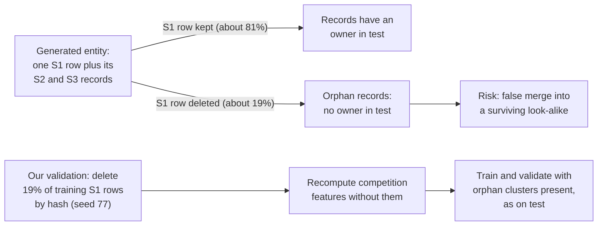
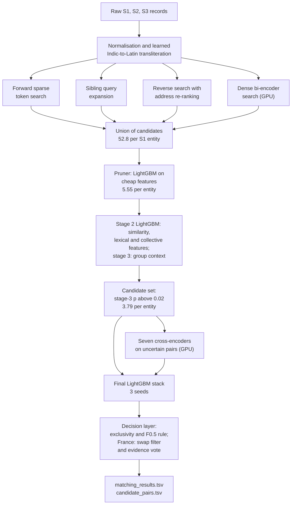
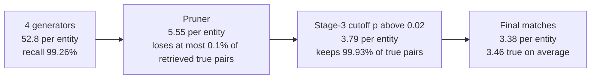
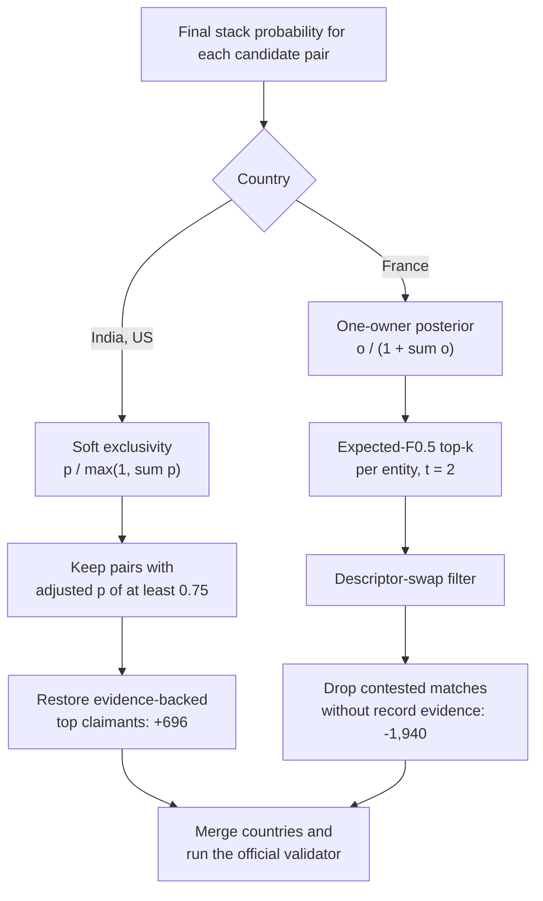
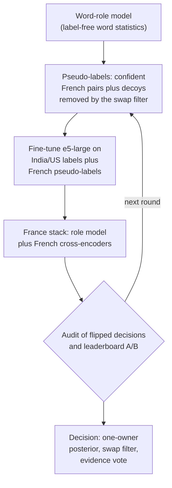
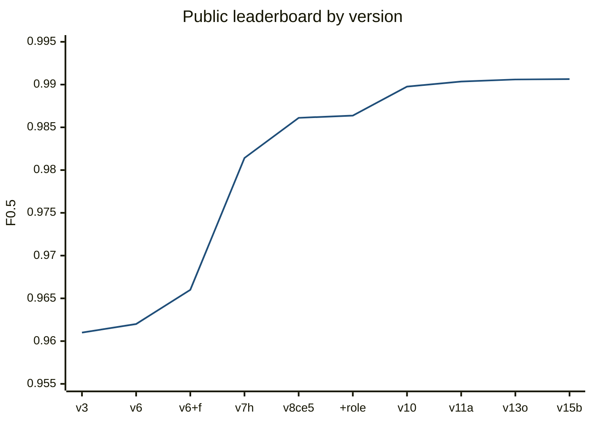

# ML Challenge 2026: Business Entity Resolution Solution

**Team Name:** Coder's Legion

**Team Members:** Dakshdeep Singh, Utsav Jha, Yashveerr Singh

**Submission Date:** 27 September 2026

---

## 1. Executive Summary

We solved the task as retrieval first and classification second. Four candidate generators with different failure modes (IDF-weighted sparse search, sibling query expansion, reverse search from records to entities, and a fine-tuned multilingual bi-encoder) feed a cascade of LightGBM filters that leaves 3.79 candidates per Source-1 entity. A LightGBM stack over seven fine-tuned multilingual cross-encoders and population-level frequency features then scores these pairs, and a decision rule derived from the metric and from the one-owner-per-record constraint selects the matches.

Two findings shaped most of the work. First, the test set was assembled by deleting about 19% of Source-1 entities while keeping their records, and we reproduced that inside our validation. Second, France has no training data at all, so it needed a label-free adaptation: language-independent word statistics, self-training on pseudo-labels, and a record-level evidence check for contested records.

| Key figure | Value |
|---|---|
| Validation macro F0.5, India and US, test-like conditions | 0.9912 (0.9910 at test decoy density) |
| Public leaderboard, final submission | 0.990642 |
| Candidate pairs in `candidate_pairs.tsv` | 6,558,404 (3.79 per Source-1 entity) |
| Recall of true pairs before the final candidate cutoff | 99.26% |

---

## 2. Methodology

### 2.1 Problem Analysis

We scanned the full training data (2.21M Source-1 entities, 5.03M Source-2 and 5.29M Source-3 records) and the test sources before writing any model code. Below, S1, S2 and S3 denote the three sources.

#### The metric sets the operating point

F0.5 is averaged per S1 entity, so each entity counts equally and precision weighs twice as much as recall. Take an entity with four true matches of which three are found (score 0.9375). One more candidate raises the score to 1.0 if it is right and lowers it to 0.75 if it is wrong, so it is worth adding only when its probability of being right exceeds 0.75. An entity with no match scores 1.0 when left empty and 0 otherwise, so the system also has to be willing to predict nothing. These two facts determine the decision rule in Section 4.3.

#### Match structure

An S1 entity has 3.46 matches on average, usually spread over both sources and rarely more than eight, and 5.58% of entities have none. These rates are the same in India and the US, which points to global generator parameters. Every S2 or S3 record belongs to at most one S1 entity (none of the 7.6M matched records is shared), matches never cross countries, and about 26% of training records match nothing.

#### How the test set was built

The number of matches per entity is a generator constant, yet test has 5.75 S2/S3 records per S1 entity against 4.68 in training. In addition, 31% of the test records that no entity plausibly owns have a near-identical sibling that is also unowned, against 2.5% of training distractors. Both observations fit a test set built by deleting about 19% of S1 entities and keeping all of their records (1 − 4.68/5.75 ≈ 0.19).

The deletion matters because the orphaned records look exactly like true matches of any similar entity that survived. A model trained on complete data learns that a record nobody else claims is probably yours, and on the test set that belief produces false merges. We therefore delete the same share of training entities with a fixed hash (`simulate_drop.py`) and recompute every competition feature without them (Figure 1). This corrected the meaning of those features. On its own it explained only about 0.001 of the early 0.010 gap between validation and leaderboard; a leaderboard probe later showed that France accounted for about two thirds of that gap.


*Figure 1. How the test set was constructed and how our validation reproduces it.*

#### Noise in names and addresses

True matches differ from the S1 record in many ways at once. The name patterns we catalogued were:

- typos and added accents;
- shuffled or duplicated words;
- legal forms that are dropped, changed or moved to the front (LLC, Inc, Pvt Ltd, SARL, SAS);
- noise such as "--", "##", "(ID: 88889)" or "formerly:";
- domain-style names (`valleyguild.com`);
- initialisms ("ESD" for EHPAD Saint Dame);
- names written in nine Indic scripts;
- records renamed to invented words built from a small syllable set ("Synwex", "Jaxorbi"), which can only be linked through the address.

Addresses vary in street-type abbreviations, state names against codes (Texas and TX, Maharashtra and MH), house-number formats (0071, H.No 71, #6449, 6449-6453, 17 b, 56 bis), digit typos (728 for 28) and the order of components. In France the region may appear on one side and the department on the other (Hauts-de-France against Nord).

#### Missing fields

4.4% of matched records have an empty address, independently per record. Because the generator reuses names across cities, these records carry most of the unavoidable error. In training, an empty-address record that carries the S1 core name but drops its legal form is a true match only 29% of the time.

#### Injected decoys

The generator also creates different businesses that are made to look like matches.

| Decoy pattern | Example | Why it is hard |
|---|---|---|
| Same name, nearby house number | "RE Petroleum, 4620 Mill View Ct" against "RE Petroleum [Co], 4622 Mill View Ct" | True matches also receive number typos |
| Different business at the same address | "Netti F. Mclean, DO" against "Netti F. Mclean, DOJ LLC" | Reads like a typo plus a legal suffix |
| One descriptor word swapped | "Cmp Club SA" against "Cmp Section SA" | True matches add alias words such as "Center" |
| Confusable real name | "Kelly & Stone" against "Zeller & Stone" | Reads like a typo |
| Empty-address copy of a common name | "Vega" with no address while six Vega entities exist | Cannot be attributed from the record alone |

#### France

15% of test S1 entities are French, and training contains no French data. French names come from a small vocabulary, typically a generic word plus a city ("Lille Amis", "Pessac Club"). At equal population size, about 3.4 times more S1 entities share a name than in India or the US (21.7 against 6.4 on average). The legal forms and street words are new, and France has its own decoy pattern, the one-word descriptor swap shown above.

Finally, we checked for shortcuts and found none: file order and entity IDs carry no signal (the correlation of ID values across matched records is 0.0003, and modular tests are at chance level).

### 2.2 Solution Strategy

**Approach Type:** Hybrid. Multi-source blocking, a cascade of learned filters, gradient-boosted matchers stacked with transformer cross-encoders, and a global decision layer that enforces one owner per record.

**Core Innovation:**

1. A validation setup that mirrors how the test set was constructed: the entity deletion, the test's roughly doubled density of ownerless decoy candidates, and a separate measurement of France. With all three in place, validation predicted the leaderboard: +0.0042 predicted against +0.0047 observed for v8, and for v10 the weighted estimate (0.85 × India/US validation + 0.15 × France proxy, both at doubled decoy density) was 0.98982 against 0.98977 observed.
2. Four candidate generators chosen for their different failure modes. They include reverse search from records to entities, and a bi-encoder trained only on entities that the downstream models never see.
3. Lexical target encoding, which learns which kind of word difference separates a variant of the same business from a decoy.
4. Collective features, in the sense of Fellegi-Sunter term-frequency adjustment, and a twin-aware cross-encoder for records whose name is shared by several entities.
5. A label-free adaptation to France, and an exclusivity layer derived as a posterior under the one-owner constraint, combined with a record-level evidence vote for contested records.


*Figure 2. End-to-end pipeline. France follows the same path, with the language-agnostic role model in place of stages 2 and 3 (Section 4.4).*

#### Validation design

All modelling uses a hash-based 30% sample of training S1 entities. We use blake2b keyed with a seed, because crc32 produced correlated splits. A further hash-based 20% of that sample, about 107,000 entities after the simulated deletion, is held out for validation and for training the stacked models by 2-fold cross-fitting. Every score is computed with the official metric, singleton rule included.

The test set also carries about twice as many ownerless decoy candidates, so each decision rule was evaluated twice: as is, and with every decoy candidate counted twice. We adopted only rules that won under both. France cannot be scored with labels. We measured it with leaderboard uploads in which only the French rows changed, and we audited every French change by reading samples of the decisions it flipped.

---

## 3. Candidate Generation (Blocking)

Blocking is a cascade. Each stage keeps recall high and removes pairs that the next stage would never select.

| Stage | Candidates per S1 entity (test) | Pairs on test |
|---|---|---|
| Union of the four generators | 52.8 | about 91.6 million |
| Learned pruner | 5.55 | about 9.6 million |
| Candidate set (stage-3 probability above 0.02) | 3.79 | 6,558,404 |
| Final matches | 3.38 | 5,853,152 |


*Figure 3. The candidate cascade on the test set.*

#### Normalisation

Names are lowercased and transliterated. Legal forms (US, Indian and French) are moved to their own field, "doing business as" names are split out, and domain names are reduced to their root. Addresses go through country-specific abbreviation tables, including French ones (r to rue, bd to boulevard); state names are mapped to codes, and house numbers are normalised and stored separately. Words in Indic scripts are mapped to Latin with a dictionary learned from co-occurrence in training pairs, since external transliteration services were not allowed. Words that appear only in test are mapped to the test S1 vocabulary by consonant skeleton (`normalize.py`, `translit.py`).

**Blocking keys used:** records are indexed by typed tokens, each type with its own weight and document-frequency cap.

| Key type | Content | IDF weight | Frequency cap |
|---|---|---|---|
| Name words | core words, compact name, DBA name; abbreviation variants on the query side | 1.0 | 4,000 |
| Name word pairs | unordered pairs among the first six core words | 0.3 | 2,000 |
| Name 4-grams | character 4-grams of the compact name | 0.4 | 3,000 |
| Address words | words of three or more letters | 2.0 | 3,000 |
| House number and street | first three numbers crossed with street words | 1.05 | 1,500 |
| Numbers | numbers with at least two digits | 1.4 | 1,500 |
| Dense embedding | multilingual-e5-small vector of "name \| address" | cosine similarity | none |

We tuned the weights on a US probe, where recall at 15 candidates per source rose from 95.6% to 96.7%. Tokens above their cap are dropped from the index. This keeps the sparse product cheap, but it also drops common street and city words, a weakness the reverse search was built to address.

#### The four generators

Forward token search (`retrieve.py`) represents queries and records as sparse IDF-weighted vectors, per country and source. A CSR matrix product scores all pairs, and we keep the top 20 records per source. Increasing that number did not help, since recall plateaued near 96% as K grew.

Sibling query expansion (`expand.py`) reuses records the pruner already trusts (probability of at least 0.9) as new queries, because an entity's records often resemble each other more than they resemble the S1 row. It added 0.77 points of recall.

Reverse search with re-ranking (`retrieve_rev.py`, `retrieve_rerank.py`) lets each record query the S1 index. That index is about five times smaller and has clean addresses, so common street words stay under the frequency cap, and each record keeps its top three entities. This recovered about half of the matches the forward search never found and raised the oracle ceiling (the score of a perfect classifier on the candidates) from 0.983 to 0.992. Some records have a near tie at the top: common names such as "Foot & Ankle Partners" are shared by 264 entities. For those, we re-rank the reverse top 100 with

`token_set(address) + 0.5 · partial(address) + 40 · [same first house number] + 0.3 · token_set(name)`

and keep three. In its first version (reverse top 50, keep two), this step raised validation recall from 97.64% to 98.22%.

The dense bi-encoder (`dense_export.py`, `colab_dense.py`, `merge_dense.py`) is multilingual-e5-small (MIT), fine-tuned with a symmetric InfoNCE loss: in-batch negatives plus one hard negative per pair mined with the base model, temperature 0.05, batch 512, one epoch. It is trained on 1.2M matches from the 70% of training entities that no downstream model uses, which keeps its scores honest on validation; for half of those entities the positive is the entity's least similar record. Search is exact cosine top-k on a GPU in both directions: the top 3 entities for each record and the top 5 records for each entity. As on test, the deleted entities are left out of the training index. The retriever found 56.9% of the true matches the three token generators missed and lifted blocking recall from 98.30% to 99.26%.

#### Learned filters

The pruner (`prune.py`) is a LightGBM on cheap features: token overlaps, every generator's rank and score, reverse competition, and two fast string similarities. It is 2-fold cross-fitted by entity, so the next stage trains on the same kind of candidates it will see on test, and its threshold is set to lose at most 0.1% of retrieved true pairs.

After the stage-2 and stage-3 matchers (Section 4), pairs with stage-3 probability at or below 0.02 are removed; for France the role model's probability is used instead. On validation this removes a third of the candidates (4.93 to 3.58 per entity) and keeps 99.93% of true pairs, at a cost of 0.00002 in F0.5. The final models are trained and applied only on these pairs, so for every S1 entity `candidate_pairs.tsv` lists exactly the pairs scored by the model that decides that entity (the India/US stack or the France stack).

**Candidate pairs generated:** 6,558,404, i.e. 3.70 per entity in India, 3.82 in the US and 3.97 in France. Entities have 3.46 true matches on average, so this is close to the minimum possible. Against the 1.4 to 4.7 million records of an entity's country, the reduction ratio is above 99.9999%. 4.55% of test entities have no candidate at all, consistent with the 5.58% singleton rate.

**How we ensured true matches were not lost:** we measured recall at every stage on validation with labels, together with the oracle ceiling. The ceiling was 0.9812 in our first full pipeline, 0.992 after reverse search, and 0.9982 after dense retrieval before the cutoff; it is 0.9974 on the final candidate set. Each generator was added to target the largest remaining bucket of misses, which we identified by reading them: partial addresses of common names led to reverse search and re-ranking, and renamed, transliterated and address-stripped records led to the dense retriever.

Every filter runs under an explicit recall budget, and we measured where losses occurred before changing any threshold. For example, only 4% of lost matches were lost at pruning, so loosening the pruner would have gained little while enlarging the candidate file.

What remains cannot be resolved from the data. 0.65% of true pairs are never retrieved; 94% of them are empty-address records, and most carry a name shared by five or more entities. Widening the search showed steeply diminishing returns: the true matches found only at reverse rank 1, 2 and 3 numbered 14,624, 2,061 and 1,102.

---

## 4. Matching Model

### 4.1 Features

**Features used:** about 190 features feed the stage-2 matcher. Country is never a feature, because the test set contains a country that training does not.

- **Name features:**
    - rapidfuzz ratio, token_set, token_sort, partial and WRatio, plus Jaro-Winkler, computed on the core name, the compact name and a cleaned variant;
    - extra and missing tokens; legal-form agreement; an abbreviation match; a domain flag;
    - the share of record words absent from the country's S1 vocabulary. This separates invented rebrand names, which are true 78% of the time at the same address, from real-looking distractors (16%).
- **Address features:** similarities on the normalised address and on address words, with and without administrative words; state agreement; empty-address flags.
- **Number features:** equality of the first house number, edit distance between numbers, prefix match, a dropped digit, log difference, and shared or one-sided numbers.
- **Other:**
    - IDF-weighted overlaps per key type;
    - the rank and score from every generator;
    - reverse competition: how many entities claim the record, and this entity's rank and score ratio among them, all recomputed under the simulated deletion;
    - group context from comparing each candidate with the entity's most confident other candidate. True sibling records agree with each other, while a decoy cluster at a neighbouring house number agrees only internally;
    - the lexical and collective features described next.

Lexical target encoding (`lexical.py`) splits each pair's name difference into five parts:

- typo variants;
- real-name variants;
- extra words and missing words;
- a number-change type (equal, one digit dropped or inserted, near, far);
- the legal-form change.

Each part is replaced by its smoothed match rate in training, computed out of fold with two folds by entity and a prior weight of 20. The model learns, for example, that an added "Center" or "Services" is an alias, while replacing "Clinic" with "Projects" or adding "Holdings" signals a different business.

Collective features (`coll_feats.py`) are counted over the entities present in the split, with the simulated deletion applied. They follow the term-frequency principle of record linkage: agreeing on a rare value is strong evidence, and agreeing on a common one is weak. They lowered stage-2 validation log loss from 0.0407 to 0.0388.

| Feature group | Meaning |
|---|---|
| Name and address frequency | Number of present S1 entities sharing this entity's name, the record's name, this entity's address, and its house number with street word |
| Record density | Number of records carrying the name or address, and records per entity. The generator averages about 3.5, so a much higher density signals orphans of deleted look-alikes |
| Raw-name twins | The record's raw spelling (case, punctuation, legal-form spelling) compared with this entity and with every other present entity of the same normalised name, plus the margin between them. For example, `Choudhary (indit) Private Limited` belongs to `Choudhary (india) Private Limited`, not to `Choudhary India Private Limited` |

### 4.2 Models

**Model type:** a cascade of LightGBM models plus fine-tuned transformer cross-encoders.

| Stage | Model | Trained on | Purpose |
|---|---|---|---|
| Pruner | LightGBM, 63 leaves, 400 rounds | training sample, 2-fold cross-fit | cut 52.8 to 5.55 candidates per entity |
| Stage 2 | LightGBM, 127 leaves, learning rate 0.06, up to 3,000 rounds | 2.1M training pairs under simulated test conditions | main pair probability |
| Stage 3 | small LightGBM | validation predictions, 2-fold cross-fit | group context; defines the candidate set |
| Cross-encoders | seven fine-tuned multilingual transformers | 0.7M to 3.1M training pairs | read the raw text of both records jointly |
| Final stack | LightGBM, 15 leaves, 300 rounds, 3 bagged seeds | validation, 2-fold cross-fit | combine all signals |

Capacity was chosen by validation. A 511-leaf stage 2 had worse log loss (0.04104 against 0.04070). The stack is trained on about 400,000 validation pairs whose inputs are already strong model scores, and 31 or 63 leaves were both worse than 15.

Each cross-encoder reads "name | address" of the S1 row and of the record as one sequence and outputs a match logit (`colab_export*.py`, `colab_ce.py`). Fine-tuning setup:

- binary cross-entropy;
- AdamW at 5e-5 (3e-5 for LaBSE) with 5% warm-up and linear decay;
- one epoch, sequences of up to 128 tokens (192 for the twin-aware model), mixed precision;
- base training set: all hard training pairs (pruner probability between 0.01 and 0.99) plus 250,000 easy ones, 1.2M pairs in total. The other sets extend it (3.1M pairs), re-sample it from the final candidate distribution, keep the pairs that have a same-name twin, or add French pseudo-labels.

The cross-encoders score only the uncertain band of stage 2 (probability between 0.005 and 0.995), identically on validation and test, so the stack sees the same coverage on both. Outside the band the feature is missing, which LightGBM handles natively.

The seven models are:

1. paraphrase-multilingual-MiniLM-L12-v2;
2. multilingual-e5-base;
3. multilingual-e5-large, trained on 1.2M pairs;
4. multilingual-e5-large, trained on 3.1M pairs;
5. LaBSE, added for architectural diversity;
6. multilingual-e5-large, trained on the hard pairs of the final candidate distribution;
7. a twin-aware multilingual-e5-large that reads "S1 row ‖ closest same-name twin" against the record, so each entity is judged against the best alternative explanation of the record.

The final stack (`final_v11.py`) takes as input:

- the stage-2, stage-3 and role-model logits;
- the seven cross-encoder logits;
- the collective, density and twin features;
- a few pairwise features.

Its feature groups were chosen by greedy forward selection on validation, scored with the official metric (`greedy_run.py`).

### 4.3 Decision rule

**Threshold selection method:** the decision layer (`decide.py`) first adjusts each probability for competition over the same record, then selects per entity.

For India and the US we use soft exclusivity, p / max(1, Σp) over all entities claiming the record, followed by a threshold of 0.75, the break-even point derived in Section 2.1. A grid search over exclusivity modes, thresholds and expected-F0.5 top-k rules, scored with the official metric at decoy density ×1, ×2 and ×3, confirmed this rule at every density. Per-segment thresholds, and a rule that gives empty rows their best candidate, did not help.

For France we use the posterior that an entity owns the record given that at most one entity does. With independent claims and odds o = p / (1 − p), this is

p' = o / (1 + Σ o_j), with the sum over all claimants j.

An owner at 0.99 facing a rival at 0.4 keeps 0.98, while three near-equal claimants each fall to about 0.3. Selection then uses expected-F0.5 top-k per entity with a conservative weight on the empty prediction (t = 2).

Contested records needed one more step (`contest_filter.py`). Validation contains only about 6% of the entities that remain after the deletion, so a record's rival claimant is usually missing from it. On test every rival is present, and a strong match loses its record to exclusivity about 15 times more often (0.20% against 0.013% of entities). For a claimant X and a rival Y, we let the record itself vote:

| Evidence in the record | Weight |
|---|---|
| A house number (including bis, ter and letter suffixes) shared with only one of them | 2 |
| X's initials | 2 |
| Distinctive address words | 2 |
| The legal form | 1 |
| Name similarity on character trigrams | 1 |

In France a contested match, meaning one whose rival has probability 0.5 or more, is kept only if the record favours it over every rival. This removed 1,940 coin-flip matches, typically a random alias record at an address shared by two or three French businesses. In India and the US, a record's top claimant (p ≥ 0.75) that soft exclusivity had dropped is restored when the record favours it over every rival with p ≥ 0.3; this restored 696 matches.


*Figure 4. The decision layer.*

### 4.4 France: adaptation without labels

France is 15% of the test set and has no training data. Every component that learned vocabulary misread French. The lexical encoder and the cross-encoders trained on India and the US dropped true alias records such as "Lille Centre SARL" against "Lille SARL Et Fils" at the same address, and they accepted decoys at other house numbers. The collective features improved the India/US proxy by 0.0003 to 0.0005 but would have dropped 11,000 to 15,000 true French alias matches: French names repeat 3.4 times more, so name counts mean something else there.

We therefore measured France with leaderboard uploads that changed only the French rows. This isolates France exactly: each 0.001 on the leaderboard is 0.0067 on France. We also audited every candidate change by reading samples of the decisions it flipped.


*Figure 5. The France adaptation loop, run three times.*

The word-role model (`train_lex.py --agnostic --role`) replaces word identities with statistics measured on each country's own candidate pairs, without labels:

- how often a word replaces a name word rather than being added;
- how often its records keep the S1 house number or sit at a nearby one;
- how often the resulting name and number belong to another existing entity (the "own rate");
- how frequent the word is among S1 names.

The model learns what these statistics mean on India and the US and applies them unchanged to France. A French-only leaderboard comparison measured +0.0017 on France.

We then self-trained a French cross-encoder (multilingual-e5-large) over three rounds:

- **Round 1** added 600,000 French pseudo-labels to 1.2M labelled India/US pairs: positives the role model scored at least 0.97 and the France output kept, negatives it scored at most 0.03, and the pairs removed by the swap filter.
- **Round 2** drew its labels from the stack of the role model and the round-1 cross-encoder, and kept a pseudo-label only when the two views did not strongly disagree, which limits confirmation bias.
- **Round 3** repeated this on the final France stack (role model plus rounds 1 and 2), with about 700,000 pseudo-labels, half positive and half negative. It is our strongest French scorer on the India/US uncertain band (AUC 0.9467, against 0.9466 and 0.9437 for rounds 2 and 1).

Audits showed each round adding real French variants, such as "EURL" against "E.U.R.L." and typographic variants at the same address, and removing generic empty-address copies.

The descriptor-swap filter (`swap_filter.py`) looks at French pairs whose names differ by one replaced word. It identifies the alias words (fils, cie, services, associés, développement, france, groupe) from two label-free statistics: how often the word appears among swaps, and its own rate. Business-type words such as club, école and section have an own rate of 25 to 35%, against 0 to 6% for alias words. Matches that swap in a non-alias French business word are removed. The filter gained +0.004 on the leaderboard, about +0.027 on France.

For the decision itself, the French model often gave several claimants of the same record a probability near 1. The typical case is a random alias record at an address shared by three businesses. Hard exclusivity picked one of them arbitrarily and was right about once in two or three, while soft exclusivity removed too much, and an audit found it dropping clear owners. The one-owner posterior plus the evidence vote removes only the genuine coin flips. Together with the round-3 model they gained +0.00029 on the leaderboard, where the India/US proxy predicted about +0.00002. The size of that gap suggests that most of the removed French matches had been wrong.

---

## 5. Results & Error Analysis

**F_0.5 Score (macro):**

| Measurement | Score |
|---|---|
| Validation, India and US, test-like conditions | 0.99117 (0.99100 at test decoy density) |
| Validation by country | India 0.99177, US 0.99077 |
| France model scored on India/US validation (proxy) | 0.98982 |
| Oracle ceiling on the final candidate set | 0.9974 |
| Public leaderboard, final submission | 0.990642 |

| Version | Main change | Validation F0.5 | Public LB |
|---|---|---|---|
| v3 | token retrieval, pruner, LightGBM, expected-F0.5 decision | 0.9714 (before simulation) | 0.961 |
| v6 | training and validation under the simulated deletion | 0.9731 | 0.962 |
| v6 + filter | French descriptor-swap filter | 0.9731 | 0.966 |
| v7h | reverse search, lexical target encoding, group model | 0.9835 | 0.981415 |
| v8ce5 | tie re-ranking, five cross-encoders | 0.98788 | 0.98611 |
| v8ce5 + role | language-agnostic role model for France | 0.98788 | 0.986374 |
| v10 | dense retrieval, six-model stack, French self-training, candidate cutoff | 0.99017 | 0.989766 |
| v11a | collective, density and twin features, twin-aware cross-encoder | 0.99117 | 0.990352 |
| v13o | France round 3 and one-owner posterior | 0.99117 | 0.990597 |
| v15b (final) | evidence vote on contested records | 0.99117 | 0.990642 |

Up to v10 the leaderboard followed the weighted validation estimate closely. From v11 on it gained less than predicted (+0.0006 observed for v11a against +0.0009 estimated), so we read later validation gains as upper bounds and confirmed each final change with its own leaderboard upload.

What each component added on validation (India and US):

| Component | Effect |
|---|---|
| Sibling expansion | recall +0.77 points; F0.5 +0.0017 |
| Reverse search | oracle ceiling 0.983 to 0.992; F0.5 0.9731 to 0.9800 |
| Lexical target encoding, with the stage-3 group model | 0.9800 to 0.9829 (+0.0037 at test decoy density) |
| Five cross-encoders over the tie-re-ranked candidates | +0.0014 |
| Dense retrieval | blocking recall 98.30% to 99.26%; stage 2 +0.0024 |
| Collective, density and twin features, twin-aware cross-encoder, bagged stack | 0.99017 to 0.99117 (bagging alone +0.0001) |

**Common false positives (wrong merges):** three causes of roughly equal weight. Each figure is what fixing the bucket would add to validation F0.5.

- Orphans of deleted entities (307 validation pairs, 0.00075): a record of a deleted look-alike, often at a neighbouring house number, assigned to the surviving entity.
- Records of another present entity (273 pairs, 0.00076): typically a same-name twin in another city, or a different business at the same address with a one-word difference ("Netti F. Mclean, DO" against "DOJ LLC").
- Generated decoys (173 pairs, 0.0005): nearby house numbers, descriptor swaps and confusable names.

**Common false negatives (missed matches):**

- About 64% of missed true pairs are ambiguous by construction: an empty address, and a name shared by at least two present entities. Often the owner's twin is not even among the candidates. Raw-spelling cues recover some of these; the rest cannot be attributed.
- Other misses are true records with several edits at once (a number typo, an added suffix, a reordered name) that end up looking like decoys. Missed pairs with model probability between 0.2 and 0.5 are worth 0.0023; those below 0.2 are worth 0.0015.
- Entities predicted empty although they have matches cost 0.0016. In expectation, empty was still the right call: of the entities whose best candidate scored 0.5 to 0.75, 57.5% were true singletons.

Ideas that did not help, each measured on validation:

| Idea | Result | Reason |
|---|---|---|
| Larger stage 2 (511 leaves) or stack (31, 63 leaves) | worse | overfitting |
| More cross-encoders, including Qwen2.5-1.5B | +0.00008 or less | predictions correlated at 0.84 with e5-large |
| Exact Bayes-optimal F-measure decision (GFM) | +0.00004 | the probabilities, not the decision rule, limit the score |
| Two-pass stacking on first-pass neighbour predictions | −0.0004 | leakage through records shared across folds |
| Decoy-weighted training | −0.0001 | the decision rule already handles decoy density |
| Collective counts on a test-sized population | −0.00013 | the chance that a same-name record is yours depends on the number of same-name entities, not on population size |

---

## 6. Conclusion

Most of the score came from reading how the data was generated and how the test set was assembled, and from building retrieval around that: four generators whose failure modes do not overlap, and learned filters with explicit recall budgets. Target-encoded word differences, fine-tuned cross-encoders applied only where the matchers were uncertain, and a decision rule derived from the metric and the one-owner constraint then turned that recall ceiling into precision. The main lesson came from France: for a domain without labels, label-free statistics, audits of flipped decisions and single-variable leaderboard probes told us more than any proxy validation.

---

## Appendix

### A. Code Artefacts

`code/business_entity_resolution/`:

```text
reproduce.sh        whole pipeline, raw data -> output/, in build order
smoke_test.sh       reproduce.sh end to end on a 1.5% sample (CPU only)
README.md           setup, stages, runtimes, reproducibility notes
requirements.txt    pinned versions
config/             frozen choices: feature lists, stack features, decision rules
src/                all Python code
  normalize.py translit.py prep.py        normalisation, transliteration, tokens
  retrieve.py expand.py retrieve_rev.py
  retrieve_rerank.py dense_export.py
  colab_dense.py merge_dense.py           the four candidate generators
  make_features.py features.py prune.py
  simulate_drop.py coll_feats.py          features, pruner, deletion simulation
  lexical.py train_lex.py score_lex.py
  stage3.py                               matchers
  colab_export*.py ce_bands.py
  colab_ce.py comb_ce.py                  cross-encoders (GPU)
  stack_ce.py greedy_stack.py
  greedy_run.py final_v11.py              stacks and the feature search
  decide.py swap_filter.py
  contest_filter.py hybrid.py             decisions, France post-processing
utils/validate_submission.py              official format validator
history/            original per-version driver scripts (v3 to v15b)
```

`reproduce.sh` runs every stage the submission depends on, in order, and resumes after an interruption. The final model was built over several versions, and later versions reuse earlier artefacts: the first pruner drives sibling expansion, and the v7 and v8 candidate sets supply the cross-encoder training pairs and the first French pseudo-labels. The script therefore rebuilds those intermediate versions and skips the experiments that did not reach the submission. GPU steps (the bi-encoder and the cross-encoders) run on one CUDA GPU; everything else runs on a 4-core, 16 GB CPU machine. `smoke_test.sh` executes the same steps on a 1.5% sample of the provided data in about an hour, as a check that the code, configuration and environment are complete. From the intermediates of our run, the final stage regenerates both submitted files byte for byte.

### B. Additional Results


*Figure 6. Public leaderboard score of each submitted version.*

Validation loss budget of the final India/US model (1 − F0.5 = 0.0090 at test decoy density):

| Bucket | Share of F0.5 lost |
|---|---|
| Entities with matches predicted empty | 0.0016 |
| Predictions made for true singletons | 0.0002 |
| Partially wrong entities | 0.0072 |
| of which true pairs never retrieved (approximate) | 0.0016 |
| of which removed by the pruner or the cutoff (approximate) | 0.0010 |

France measured by leaderboard probes (India and US rows identical within each pair of uploads):

| Probe | Result | Reading |
|---|---|---|
| v3 with every French row empty | 0.830 against 0.961 | France scored about 0.925 at that point |
| Descriptor-swap filter | +0.004 | about +0.027 on France |
| Word-role model | +0.00026 | about +0.0017 on France |
| Round-3 cross-encoder and one-owner posterior | +0.000245 | about +0.0016 on France |

### C. Compliance

Only the provided challenge data is used: no external data, no API lookups and no geocoding. The transliteration dictionary and every frequency statistic are learned from the provided files.

Pretrained models are used as weights only and fine-tuned on challenge data. The largest has 560M parameters, far below the 8B limit.

| Model | Licence | Parameters | Use |
|---|---|---|---|
| sentence-transformers/paraphrase-multilingual-MiniLM-L12-v2 | Apache-2.0 | 118M | cross-encoder |
| intfloat/multilingual-e5-small | MIT | 118M | dense retriever |
| intfloat/multilingual-e5-base | MIT | 278M | cross-encoder |
| intfloat/multilingual-e5-large | MIT | 560M | cross-encoders, French self-training |
| sentence-transformers/LaBSE | Apache-2.0 | 471M | cross-encoder |

LightGBM is MIT licensed. For every S1 entity, `candidate_pairs.tsv` is exactly the set of pairs scored by the final model that decides it.

### D. Compute

CPU work ran on one laptop with 4 cores and 16 GB of RAM. A complete CPU pass takes roughly a day, mostly retrieval and feature building. Candidate pairs are handled as numpy arrays with 64-bit pair keys rather than as Python objects, which keeps the largest stages (about 90 million candidate pairs on test) within the laptop's memory. GPU work ran on Google Colab A100s; the dense retriever and each cross-encoder took one to two GPU hours to train and score, roughly 15 GPU hours in all.
